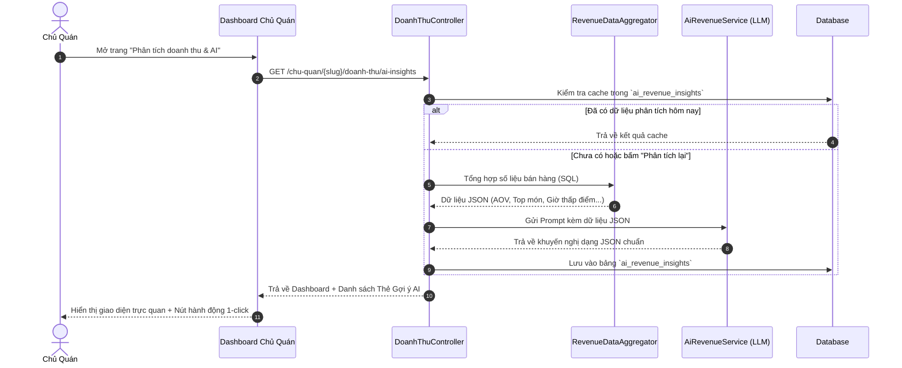

# TÀI LIỆU ĐẶC TẢ YÊU CẦU CHỨC NĂNG (SPECIFICATION)
## Tính Năng: Phân Tích Doanh Thu & Gợi Ý Hành Động Thông Minh Bằng AI (AI Revenue Analytics & Smart Insights)

* **Dự án:** QuanMoi.com (Hệ sinh thái ẩm thực & địa điểm)
* **Đối tượng sử dụng:** Chủ Quán (Restaurant/Café Owner) & Quản trị viên (Admin)
* **Phiên bản:** 1.0 (Draft)
* **Trạng thái:** Sẵn sàng triển khai

---

## 1. TỔNG QUAN & MỤC TIÊU DỰ ÁN

### 1.1. Bối cảnh & Vấn đề (Problem Statement)
* Hầu hết chủ quán ăn, cà phê vừa và nhỏ (SMB F&B) chưa có kỹ năng đọc và phân tích dữ liệu bán hàng.
* Dù có số liệu doanh thu, chủ quán vẫn lúng túng trong việc:
  * Không biết món nào đang gánh lãi, món nào đang ế làm đội chi phí nguyên liệu.
  * Không biết cách kích cầu trong các khung giờ vắng khách (giờ chết).
  * Lúng túng khi lên chương trình khuyến mãi (giảm giá bừa bãi gây lỗ hoặc giảm không đủ hấp dẫn).

### 1.2. Mục tiêu chức năng (Objectives)
* **Trực quan hóa doanh thu:** Cung cấp biểu đồ trực quan, dễ hiểu về doanh số, số lượng đơn, khung giờ vàng, món ăn hot.
* **AI Cố vấn kinh doanh F&B (AI Virtual Business Advisor):** Dùng AI tự động phân tích các chỉ số tài chính và đưa ra các **gợi ý hành động thực tế 1-chạm** (tạo combo, chạy flash sale giờ thấp điểm, tối ưu menu).
* **Khép kín luồng thực thi (Closed-loop Action):** Từ gợi ý của AI, chủ quán bấm nút là chuyển thẳng sang tạo Khuyến mãi/Menu mà không cần thao tác thủ công.

---

## 2. KIẾN TRÚC DỮ LIỆU (DATABASE SCHEMA)

### 2.1. Bảng `hoa_don` (Đơn hàng / Doanh thu)
Lưu trữ thông tin mỗi giao dịch bán hàng của quán:

| Cột | Kiểu | Mô tả |
| :--- | :--- | :--- |
| `id` | BIGINT (PK) | Khóa chính tự tăng |
| `quan_id` | BIGINT (FK) | Liên kết bảng `quan` (Quán sở hữu) |
| `ma_hoa_don` | VARCHAR(50) | Mã đơn (VD: `HD-20261104-001`) |
| `tong_tien_hang`| DECIMAL(12,2)| Tổng tiền trước giảm |
| `tien_giam_gia` | DECIMAL(12,2)| Số tiền khuyến mãi / voucher |
| `tong_thanh_toan`| DECIMAL(12,2)| Thực thu từ khách |
| `nguon_don` | ENUM | `tai_quan`, `mang_ve`, `shopeefood`, `online` |
| `trang_thai` | ENUM | `hoan_thanh`, `da_huy` |
| `thoi_gian_tao` | TIMESTAMP | Thời điểm phát sinh đơn (phục vụ phân tích theo giờ) |

### 2.2. Bảng `chi_tiet_hoa_don` (Chi tiết món trong đơn)
Lưu từng món ăn được gọi:

| Cột | Kiểu | Mô tả |
| :--- | :--- | :--- |
| `id` | BIGINT (PK) | Khóa chính |
| `hoa_don_id` | BIGINT (FK) | Liên kết `hoa_don` |
| `mon_an_id` | BIGINT (FK) | Liên kết `mon_trong_menu` |
| `so_luong` | INT | Số lượng đĩa/ly bán |
| `don_gia` | DECIMAL(12,2)| Giá bán tại thời điểm gọi |
| `thanh_tien` | DECIMAL(12,2)| `so_luong * don_gia` |

### 2.3. Bảng `ai_revenue_insights` (Lưu trữ khuyến nghị của AI)
Cache kết quả phân tích định kỳ để tiết kiệm chi phí gọi LLM API:

| Cột | Kiểu | Mô tả |
| :--- | :--- | :--- |
| `id` | BIGINT (PK) | Khóa chính |
| `quan_id` | BIGINT (FK) | Quán được phân tích |
| `ky_phan_tich` | VARCHAR(20) | `today`, `this_week`, `this_month` |
| `loai_insight` | ENUM | `combo`, `happy_hour`, `menu_matrix`, `voucher` |
| `tieu_de` | VARCHAR(255) | Tóm tắt khuyến nghị (VD: Tăng doanh thu giờ chiều) |
| `noi_dung_phan_tich`| TEXT | Giải thích nguyên nhân dựa trên số liệu |
| `de_xuat_hanh_dong` | JSON | Dữ liệu để 1-click kích hoạt (món, giá combo, % giảm) |
| `trang_thai_ap_dung`| BOOLEAN | Chủ quán đã bấm áp dụng hay chưa |
| `created_at` | TIMESTAMP | Thời gian phân tích |

---

## 3. ĐẶC TẢ YÊU CẦU CHỨC NĂNG (FUNCTIONAL REQUIREMENTS)

```
+-------------------------------------------------------------------------------+
|                       DASHBOARD PHÂN TÍCH DOANH THU                           |
+-------------------------------------------------------------------------------+
| [ Bộ lọc: Hôm nay | 7 ngày qua | Tháng này | Tùy chọn ngày ]                 |
|                                                                               |
| [ Doanh thu: 24.500.000đ ] [ Đơn: 142 ] [ AOV: 172.000đ ] [ Top: Lẩu Thái ]   |
|                                                                               |
| +------------------------------------+ +------------------------------------+ |
| | Biểu đồ Doanh thu & Tăng trưởng    | | Biểu đồ Nhiệt Giờ Vàng / Thấp điểm | |
| +------------------------------------+ +------------------------------------+ |
|                                                                               |
| +---------------------------------------------------------------------------+ |
| |  ✨ CỐ VẤN KINH DOANH AI (AI REVENUE INSIGHTS)                            | |
| |                                                                           | |
| |  [Insight 1: Khung giờ 14h-16h đang ế]                                   | |
| |   -> AI gợi ý: Tạo Flash Sale "Đồng giá 29k Trà Sữa"                      | |
| |   [Nút: Tạo Khuyến Mãi Ngay]                                              | |
| |                                                                           | |
| |  [Insight 2: Bán kèm kích cầu AOV]                                        | |
| |   -> AI gợi ý: Combo Lẩu Thái + Trà Đào (Giảm 10%)                        | |
| |   [Nút: Áp dụng vào Menu]                                                 | |
| +---------------------------------------------------------------------------+ |
|                                                                               |
| [ Ma trận Menu: Món Ngôi Sao ⭐ | Món Lãi Cao 💰 | Món Bán Chậm ⚠️ ]           |
+-------------------------------------------------------------------------------+
```

### 3.1. Phân hệ 1: Dashboard Thống kê & Biểu đồ trực quan (FR-01)
* **FR-01.1: Bộ chỉ số chính (KPI Cards):**
  * Tổng doanh thu thực tế (đã trừ giảm giá) kèm % tăng/giảm so với chu kỳ trước.
  * Tổng số hóa đơn đã phục vụ.
  * Giá trị trung bình trên một đơn hàng (AOV - Average Order Value).
  * Tỷ lệ đơn thành công vs Đơn bị hủy.
* **FR-01.2: Biểu đồ biến động doanh thu:**
  * Dạng Line/Bar Chart (Chart.js / ApexCharts).
  * Cho phép xem theo giờ (nếu lọc ngày hôm nay) hoặc theo ngày (nếu lọc tuần/tháng).
* **FR-01.3: Bản đồ nhiệt giờ cao điểm & thấp điểm (Hourly Peak Heatmap):**
  * Trực quan hóa 24 giờ trong ngày và 7 ngày trong tuần theo dải màu (Xanh lá: đông khách, Vàng: trung bình, Xám/Đỏ: ế khách).
* **FR-01.4: Phân loại thực đơn theo Ma trận F&B (Menu Engineering Matrix):**
  * **Stars (Bán chạy + Lãi cao):** Món chủ lực.
  * **Plowhorses (Bán chạy + Lãi thấp):** Cần tối ưu giá hoặc giảm lượng cost.
  * **Puzzles (Bán chậm + Lãi cao):** Cần đẩy mạnh marketing/combo.
  * **Dogs (Bán chậm + Lãi thấp):** Xem xét loại khỏi thực đơn.

---

### 3.2. Phân hệ 2: Động cơ Phân tích & Gợi ý từ AI (AI Insights Engine - FR-02)

Hệ thống gom số liệu tính toán thô (Toán học chính xác từ SQL) rồi truyền vào Prompt làm ngữ cảnh (Context) cho AI.

#### Rule & Thuật toán kích hoạt gợi ý:

#### A. Kích hoạt "Gợi ý Happy Hour / Flash Sale giờ thấp điểm"
* **Điều kiện:** Xuất hiện khung giờ liên tục $\ge 2$ tiếng có doanh thu $< 25\%$ so với mức trung bình ca.
* **Nhiệm vụ AI:**
  * Chỉ ra cụ thể khung giờ bị thấp điểm và mức thiệt hại ước tính.
  * Đề xuất loại hình ưu đãi phù hợp (VD: Quán cà phê -> Giảm giá bánh/nước; Quán lẩu nướng -> Tặng món khai vị hoặc buffet line).
  * Đưa ra mức giảm tối ưu để không bị lỗ biên lợi nhuận.

#### B. Kích hoạt "Gợi ý Combo Bán Chéo (Cross-Selling)"
* **Điều kiện:** Món A có tần suất xuất hiện cao nhất trong đơn, nhưng các món đồ uống/tráng miệng có biên lợi nhuận cao lại có tần suất đi kèm $< 20\%$.
* **Nhiệm vụ AI:**
  * Đề xuất ghép Món A + Món B thành 1 combo cụ thể kèm tên gọi hấp dẫn.
  * Định giá combo: Đảm bảo khách tiết kiệm được $10\% - 15\%$ so với mua lẻ, nhưng tổng giá trị đơn hàng tăng lên $30\% - 40\%$.

#### C. Kích hoạt "Gợi ý Voucher Nâng Hạng Đơn (Basket Size Booster)"
* **Điều kiện:** Phân phối giá trị đơn tập trung nhiều ở ngưỡng thấp (Ví dụ AOV = 75.000đ).
* **Nhiệm vụ AI:**
  * Tính mốc điều kiện áp dụng voucher = `AOV * 1.35` (VD: Đơn từ 100.000đ).
  * Gợi ý tạo mã: Giảm 15.000đ hoặc Tặng 1 đồ uống khi đơn đạt mốc trên.

---

### 3.3. Phân hệ 3: Luồng Thực thi 1-Chạm (1-Click Actionable Execution - FR-03)
Không chỉ dừng lại ở lời khuyên lý thuyết, mỗi thẻ gợi ý của AI đều có nút bấm hành động:
* **Hành động 1: "Tạo Khuyến Mãi Ngay"**
  * Bấm nút -> Chuyển trực tiếp sang module `AiPromotionService` (`KhuyenMaiController@generateAi`).
  * Tự động điền trước dữ liệu: Món áp dụng, tỷ lệ giảm, khung giờ áp dụng, tên chương trình.
  * AI tự động tạo luôn bài viết Facebook, hashtag, mã voucher.
* **Hành động 2: "Thêm Combo Vào Thực Đơn"**
  * Bấm nút -> Mở modal tạo món mới trong `MenuController`.
  * Tự động điền tên combo, danh sách món thành phần và giá bán khuyến nghị.

---

## 4. QUY TRÌNH XỬ LÝ (SYSTEM WORKFLOW & PROMPT DESIGN)

### 4.1. Sequence Diagram luồng phân tích AI



### 4.2. Cấu trúc AI Prompt & Output JSON Schema

```json
{
  "tong_quan": "Doanh thu tuần này tăng 14% nhờ món Lẩu Thái, tuy nhiên khung giờ 14h-17h đang bị lãng phí công suất.",
  "diem_sang": [
    "Món 'Lẩu Thái Hải Sản' đóng góp 42% tổng doanh thu.",
    "Khách hàng chi tiêu trung bình tăng từ 145.000đ lên 172.000đ."
  ],
  "canh_bao": [
    "Chiều thứ 2 đến thứ 5 (14:00 - 16:30) chỉ có trung bình 3 đơn/ngày.",
    "Tỷ lệ gọi kèm nước ngọt/trà chỉ đạt 18% so với số lượng món ăn."
  ],
  "goi_y_hanh_dong": [
    {
      "id": "act_happy_hour",
      "loai": "happy_hour",
      "tieu_de": "Chạy Happy Hour 'Giải Nhiệt Giờ Chiều'",
      "ly_do": "Khai thác khung giờ 14h-16h30 đang vắng khách.",
      "chi_tiet": {
        "khung_gio": "14:00 - 16:30",
        "hinh_thuc": "Dong_gia_hoac_Giam_gia",
        "noi_dung_uu_dai": "Đồng giá toàn bộ Trà Trái Cây 25k (giá gốc 40k)",
        "du_kien_tang_truong": "+15-20 đơn/ngày"
      },
      "hanh_dong_duoc_ho_tro": "tao_khuyen_mai"
    },
    {
      "id": "act_combo_cross_sell",
      "loai": "combo",
      "tieu_de": "Tạo Combo 'Bữa Trưa Năng Lượng'",
      "ly_do": "Khách gọi cơm văn phòng ít khi mua kèm canh/nước.",
      "chi_tiet": {
        "ten_combo": "Cơm Gà Xối Mỡ + Trà Tắc Khổng Lồ",
        "gia_goc": 60000,
        "gia_combo": 49000,
        "mon_thanh_phan": ["Cơm gà xối mỡ", "Trà tắc"]
      },
      "hanh_dong_duoc_ho_tro": "them_combo_menu"
    }
  ]
}
```

---

## 5. YÊU CẦU PHI CHỨC NĂNG (NON-FUNCTIONAL REQUIREMENTS)

| Tiêu chí | Yêu cầu |
| :--- | :--- |
| **Bảo mật & Quyền riêng tư** | Doanh thu là dữ liệu nhạy cảm nhất của chủ quán. Bắt buộc kiểm tra quyền sở hữu (`quan->chu_quan_id === Auth::id()`). Tuyệt đối không gửi tên khách hàng hay thông tin định danh cá nhân sang LLM. |
| **Tối ưu Chi phí API** | Dữ liệu gợi ý AI được lưu cache tối thiểu 12 - 24 giờ. Cung cấp nút "Phân tích lại ngay" nhưng giới hạn rate limit (tối đa 3 lần/ngày/quán). |
| **Smart Fallback** | Nếu API AI bên ngoài gián đoạn, hệ thống tự động chạy thuật toán heuristic nội bộ (PHP rule-based) để sinh gợi ý mẫu mà không bao giờ báo lỗi trắng trang. |
| **Tốc độ phản hồi (SLA)** | Tải dashboard thống kê $< 500ms$. Phân tích AI $< 3.5s$ (có skeleton loading đẹp mắt). |

---

## 6. LỘ TRÌNH TRIỂN KHAI (ROADMAP)

1. **Sprint 1 (Dữ liệu & CRUD cơ bản):**
   * Tạo migration bảng `hoa_don`, `chi_tiet_hoa_don`, `ai_revenue_insights`.
   * Tạo màn hình nhập/quản lý đơn hàng đơn giản hoặc import đơn mẫu cho chủ quán test.
2. **Sprint 2 (Dashboard & Charts):**
   * Vẽ biểu đồ doanh thu theo ngày/giờ bằng Chart.js/ApexCharts.
   * Thống kê Top món bán chạy, AOV, Ma trận Menu.
3. **Sprint 3 (AI Service & Smart Recommendations):**
   * Xây dựng `AiRevenueService.php` kết nối Kira AI / Gemini.
   * Tạo các card gợi ý AI trực quan trên giao diện Chủ Quán.
4. **Sprint 4 (Tích hợp 1-Chạm):**
   * Liên kết nút bấm trên card gợi ý sang `AiPromotionService` (tạo khuyến mãi tự động) và `MenuController` (tạo combo).
